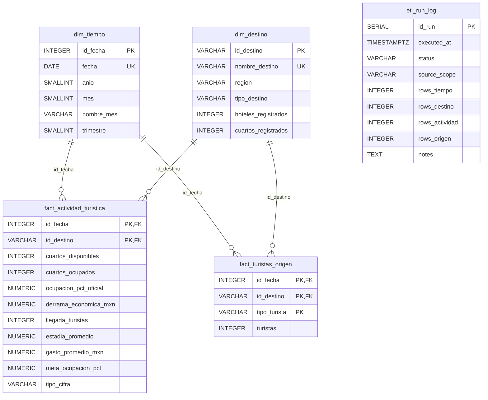

# Reporte Técnico y Académico: Dashboard de Ocupación Hotelera y Derrama Turística en Oaxaca

**Proyecto de Toma de Decisiones**  
**Fuentes oficiales:** SECTUR Oaxaca / DATATUR (SIITE) · **Fecha de corte:** Agosto 2026 (cierres anuales 2022, 2024 y 2025; preliminar enero–agosto 2026)

---

## Índice de contenido

1. [5.1. Planteamiento del problema](#51-planteamiento-del-problema)
2. [5.2. Selección de la metodología de desarrollo de software](#52-selección-de-la-metodología-de-desarrollo-de-software)
3. [5.3. Selección del lenguaje de programación y DBMS a utilizar (Modelo)](#53-selección-del-lenguaje-de-programación-y-dbms-a-utilizar-modelo)
4. [5.5. Implementación de la metodología (backend y frontend)](#55-implementación-de-la-metodología-backend-y-frontend)
   - [5.5.1. Proceso ETL (códigos Python)](#551-proceso-etl-códigos-python)
   - [5.5.2. Visualización efectiva (KPIs y dashboard)](#552-visualización-efectiva-kpis-y-dashboard)

---

# 5.1. Planteamiento del problema

## 5.1.1. Contexto turístico del estado de Oaxaca

El sector turístico constituye uno de los principales motores económicos, sociales y culturales del estado de Oaxaca. Su oferta combina patrimonio histórico y arquitectónico, gastronomía, tradiciones indígenas y destinos de sol y playa de proyección nacional e internacional. Sin embargo, el desempeño turístico estatal presenta una marcada heterogeneidad territorial y temporal que condiciona la planeación de la capacidad hotelera, la promoción institucional y la distribución de la derrama económica.

En términos geográficos, la demanda de hospedaje y el gasto turístico se concentran históricamente en tres grandes polos turísticos monitoreados de forma sistemática por las autoridades estatales y federales: **Ciudad de Oaxaca** (Valles Centrales, turismo cultural y de negocios), **Bahías de Huatulco** (turismo de playa planeado y de mayor estancia) y **Puerto Escondido** (turismo de playa, surf y naturaleza). En contraste, los otros seis segmentos territoriales registrados en los indicadores oficiales —**Tuxtepec**, **Istmo de Tehuantepec**, **Mixteca**, **Juquila**, **Ventanilla Puerto Ángel** y **Resto del Estado**— exhiben volúmenes diferenciados de infraestructura hotelera, llegada de turistas y derrama económica.

## 5.1.2. Problemática identificada

A partir del análisis del ecosistema de información turística disponible para Oaxaca, se identifican cuatro problemáticas centrales que limitan la toma de decisiones oportuna y basada en evidencia:

1. **Concentración desigual entre destinos:** La actividad hotelera y la llegada de visitantes exhiben una fuerte polarización hacia los tres centros turísticos consolidados. Sin comparativos claros de cuartos disponibles, cuartos ocupados, porcentaje de ocupación y derrama económica por destino, resulta complejo dimensionar las brechas de desempeño y orientar estrategias de promoción diferenciadas.
2. **Fuerte estacionalidad de la demanda:** La ocupación hotelera en Oaxaca responde de manera pronunciada a ciclos vacacionales y festividades emblemáticas —como la Guelaguetza (julio), Día de Muertos (finales de octubre e inicios de noviembre), Semana Santa y el periodo decembrino—, mientras que en meses de temporada baja (por ejemplo, septiembre u otros meses valle) la demanda desciende de forma significativa. Esta variabilidad dificulta evaluar si los cambios mensuales obedecen a variaciones estacionales esperadas o a caídas interanuales reales.
3. **Dispersión y formato estático de los datos oficiales:** La información pública emitida por la Secretaría de Turismo del Estado de Oaxaca (**SECTUR Oaxaca**) y el Sistema Nacional de Información Estadística del Sector Turismo de México (**DATATUR** de SECTUR Federal) se difunde principalmente a través de boletines en formato PDF (mensuales, trimestrales o anuales) y reportes tabulares independientes. Esta fragmentación impide realizar cruces históricos ágiles, comparativos interanuales (*Year-over-Year*, YoY), análisis por procedencia del turista (nacional frente a extranjero) o consultas interactivas filtradas por periodo y destino.
4. **Riesgo de errores de agregación y lectura en indicadores:** Cuando las series estadísticas se analizan manualmente en hojas de cálculo, es frecuente promediar porcentajes de ocupación de distintos meses o destinos de distinto tamaño. Este error metodológico distorsiona la realidad operativa, ya que asigna el mismo peso a destinos o periodos con distinta oferta de cuartos disponibles; los indicadores compuestos deben calcularse como razones de sumas ponderadas por capacidad y demanda real.

## 5.1.3. Pregunta de investigación

> ¿Cómo diseñar e implementar una arquitectura analítica reproducible —compuesta por un proceso ETL en Python, un modelo dimensional en PostgreSQL y un dashboard interactivo en Plotly Dash— que consolide los registros oficiales de ocupación hotelera, llegada de turistas y derrama económica en Oaxaca para apoyar la toma de decisiones basada en evidencia?

## 5.1.4. Objetivos

### Objetivo general
Desarrollar una plataforma analítica descriptiva e interactiva que extraiga, valide, modele y visualice los indicadores oficiales de ocupación hotelera, flujo de turistas por origen y derrama económica de los principales destinos turísticos de Oaxaca, permitiendo identificar brechas territoriales, patrones de estacionalidad y variaciones interanuales.

### Objetivos específicos
1. **Recopilar y documentar fuentes oficiales verificables** de SECTUR Oaxaca y DATATUR, manteniendo trazabilidad explícita de URLs, periodicidad, metodología de integración y fecha de corte.
2. **Diseñar un modelo dimensional en PostgreSQL** bajo esquema estrella/constelación que separe la granularidad de los hechos de actividad hotelera respecto al desglose por origen del turista (nacional y extranjero), garantizando integridad referencial y evitando duplicaciones al consultar vistas agregadas.
3. **Construir un proceso ETL automatizado e idempotente en Python** capaz de limpiar, validar rangos, verificar llaves foráneas, generar archivos procesados en CSV y cargar los datos en PostgreSQL con bitácora de ejecución.
4. **Implementar un dashboard interactivo en Plotly Dash** con al menos siete KPIs clave calculados mediante razones de sumas, comparativos contra el año anterior, análisis por destino y origen de visitantes, filtros dinámicos, descarga de datos filtrados y soporte dual (PostgreSQL o respaldo en CSV).
5. **Asegurar la calidad técnica y documental** mediante pruebas automatizadas (`pytest`), verificación del servidor web y alineación estricta entre el código, los datos reales y la documentación del proyecto.

## 5.1.5. Alcance y limitaciones

- **Alcance analítico:** El sistema es de carácter **descriptivo y diagnóstico**. Permite explorar series históricas oficiales mediante tarjetas de indicadores, series temporales interanuales, comparativos entre destinos, mapas de calor de estacionalidad y composición de turistas por origen, así como exportar los subconjuntos filtrados en formato CSV.
- **Granularidad oficial:** La resolución temporal y geográfica del tablero se ajusta estrictamente a la granularidad disponible en las publicaciones oficiales de SECTUR Oaxaca y DATATUR, sin fabricar registros sintéticos para rellenar periodos o destinos no publicados.
- **Actualización por lote (*batch*):** La ingesta y actualización de la información se realiza mediante ejecución controlada de los scripts de descarga y ETL, no mediante conexión transaccional en tiempo real.
- **Exclusiones:** El proyecto no implementa modelos predictivos (*forecasting*), fijación dinámica de precios (*revenue management* automatizado) ni gestión operativa de reservaciones de establecimientos individuales.

---

# 5.2. Selección de la metodología de desarrollo de software

## 5.2.1. Análisis comparativo de metodologías

El desarrollo de una solución de inteligencia de negocios y analítica turística requiere coordinar tareas interdependientes de extracción de fuentes oficiales heterogéneas, modelado dimensional en base de datos, construcción de reglas de validación y diseño de visualizaciones ejecutivas. Con el fin de elegir el marco de trabajo más adecuado para el proyecto, se evaluaron tres metodologías ampliamente utilizadas en ingeniería de software: **Scrum**, **Cascada (Waterfall)** y **Kanban**.

- **Cascada (Waterfall):** Organiza el desarrollo en fases secuenciales rígidas (requisitos, diseño, implementación, verificación y despliegue). Resulta útil cuando las especificaciones y los formatos de entrada son completamente estables desde el inicio, pero presenta alta fricción cuando los boletines oficiales o la estructura de datos exigen ajustes iterativos tras inspeccionar las fuentes reales.
- **Kanban:** Privilegia el flujo continuo de tareas y la limitación del trabajo en progreso (*Work In Progress*, WIP) sin iteraciones de duración fija. Aunque favorece la visibilidad del avance operativo, carece por sí solo de hitos formales de revisión por incremento y de una cadencia estructurada para alinear entregables académicos y técnicos acoplados.
- **Scrum:** Estructura el trabajo en iteraciones cortas denominadas *Sprints* con objetivos concretos, roles definidos, un *Product Backlog* priorizado y criterios de aceptación explícitos por incremento. Permite validar tempranamente los datos reales extraídos, ajustar el modelo dimensional antes de construir el tablero y realizar auditorías continuas de calidad.

### Matriz de decisión comparativa

Cada criterio se evaluó en una escala de **1 (bajo)** a **5 (alto)** considerando las necesidades reales de un proyecto de analítica de datos turísticos con múltiples componentes técnicos:

| Criterio de evaluación | Peso | Cascada | Kanban | Scrum | Justificación aplicada al proyecto |
|---|---|---|---|---|---|
| Adaptabilidad ante hallazgos en fuentes oficiales (PDF/tablas) | 25% | 2 | 4 | **5** | La estructura real de los boletines de SECTUR/DATATUR suele requerir ajustes iterativos en el parseo y en el esquema dimensional. |
| Entrega incremental verificable (ETL -> BD -> Dashboard -> Pruebas) | 25% | 1 | 3 | **5** | Permite entregar módulos funcionales probados al cierre de cada Sprint sin esperar al final del proyecto. |
| Claridad de roles y coordinación paralela | 20% | 3 | 3 | **5** | Facilita dividir responsabilidades claras entre ingeniería de datos, frontend analítico, documentación y auditoría de calidad. |
| Control de calidad y validación temprana | 15% | 2 | 3 | **5** | Cada incremento se somete a criterios de aceptación y pruebas antes de integrarse al siguiente componente. |
| Trazabilidad académica y gestión de alcance acotado | 15% | 4 | 3 | **4** | La estructura de Sprints y Backlog documenta de manera ordenada el avance por etapas dentro del calendario académico. |
| **Puntuación ponderada total (máx. 5.00)** | **100%** | **2.25** | **3.25** | **4.85** | **Scrum obtiene la mayor puntuación ponderada.** |

Con base en la matriz de decisión (**4.85 / 5.00**), se selecciona **Scrum** como metodología de desarrollo de software del proyecto.

## 5.2.2. Definición de roles bajo Scrum

| Rol Scrum | Responsabilidad principal en el proyecto |
|---|---|
| **Product Owner (PO)** | Define la visión del producto analítico, prioriza el *Product Backlog*, establece las reglas de negocio de los KPIs turísticos (razón de sumas, comparativo interanual) y valida la fidelidad con las fuentes oficiales. |
| **Scrum Master / Coordinación** | Asegura la aplicación del flujo Scrum, coordina dependencias entre datos, base de datos, dashboard y documentación, y resuelve bloqueos técnicos del entorno. |
| **Equipo de Desarrollo — Datos y ETL (`data-etl`)** | Configura el entorno Python, implementa la descarga reproducible de fuentes oficiales, diseña el modelo dimensional en PostgreSQL (`sql/schema.sql`) y construye el pipeline ETL (`etl/etl.py`). |
| **Equipo de Desarrollo — Frontend Analítico (`dashboard`)** | Implementa la interfaz interactiva en Plotly Dash (`app.py`), las tarjetas KPI, los gráficos de narrativa visual, filtros, exportación CSV y manejo de errores. |
| **Equipo de Desarrollo — Documentación (`docs`)** | Redacta y mantiene la documentación técnica y académica (secciones 5.1 a 5.5, reporte unificado y `README.md`) garantizando consistencia con el código real. |
| **Aseguramiento de Calidad y Auditoría (`auditor`)** | Diseña y ejecuta la suite de pruebas automatizadas (`tests/` con `pytest`), verifica la ausencia de datos sintéticos en producción y audita la coherencia integral del repositorio. |

## 5.2.3. Product Backlog

| ID | Épica / Módulo | Historia de usuario / Requerimiento | Prioridad | Sprint |
|---|---|---|---|---|
| PB-01 | Datos y fuentes | Como analista, necesito descargar y registrar boletines oficiales reales de SECTUR Oaxaca y DATATUR para garantizar trazabilidad sin datos ficticios. | Alta | Sprint 1 |
| PB-02 | Modelado de datos | Como ingeniero de datos, necesito un esquema dimensional en PostgreSQL con dimensiones, tablas de hechos, restricciones `CHECK` y vistas sin duplicación de cuartos. | Alta | Sprint 1 |
| PB-03 | Pipeline ETL | Como operador técnico, necesito un script ETL idempotente en Python que valide tipos, rangos y llaves foráneas, genere CSV limpios y cargue PostgreSQL con bitácora. | Alta | Sprint 2 |
| PB-04 | Capa analítica y KPIs | Como tomador de decisiones, necesito al menos siete KPIs calculados como razón de sumas con variación interanual (YoY) para evitar sesgos de promedio simple. | Alta | Sprint 3 |
| PB-05 | Visualización Dash | Como usuario final, necesito un dashboard interactivo con filtros por año y destino, gráficas de estacionalidad, desglose nacional/extranjero y descarga CSV. | Alta | Sprint 3 |
| PB-06 | Resiliencia operativa | Como administrador, necesito operación dual (PostgreSQL o respaldo CSV) y mensajes claros ante filtros vacíos o fallas de conexión. | Media | Sprint 3 |
| PB-07 | Pruebas automatizadas | Como auditor, necesito una suite `pytest` que valide el ETL, los archivos procesados, las fórmulas KPI, los callbacks de Dash y el estado HTTP 200 del servidor. | Alta | Sprint 4 |
| PB-08 | Documentación | Como equipo académico, necesito documentar el planteamiento, metodología, modelo, implementación ETL, KPIs y guía de ejecución alineados al código real. | Alta | Sprint 4 |

## 5.2.4. Estructura de Sprints

1. **Sprint 1 — Fuentes oficiales y modelo dimensional:** Relevamiento y verificación de publicaciones oficiales de SECTUR Oaxaca y DATATUR, definición del planteamiento (5.1) y metodología (5.2), y diseño del esquema constelación en `sql/schema.sql`.
2. **Sprint 2 — Pipeline ETL y PostgreSQL:** Configuración del entorno `.venv` en Windows, implementación de `scripts/fetch_oaxaca_data.py` y `etl/etl.py`, generación de `data/processed/` y carga idempotente hacia PostgreSQL con registro en `etl_run_log`.
3. **Sprint 3 — KPIs y Dashboard interactivo en Plotly Dash:** Implementación de `app.py` y `assets/style.css` con soporte dual PostgreSQL/CSV, 9 tarjetas KPI con YoY, narrativa visual en tres momentos y descarga CSV.
4. **Sprint 4 — Pruebas, auditoría y documentación final:** Suite automatizada `pytest` en `tests/`, validación HTTP 200 del servidor Dash, auditoría integral y consolidación documental.

## 5.2.5. Criterios de aceptación y Definición de Terminado (DoD)

- **Fidelidad de datos:** Cero registros sintéticos en el flujo principal; toda cifra proviene de boletines oficiales documentados con URL y fecha de corte.
- **Integridad estructural:** `sql/schema.sql` aplica restricciones `CHECK`, llaves primarias/foráneas válidas y vistas (`vw_kpis_mensuales` y `vw_kpis_anuales_yoy`) sin duplicación de filas.
- **Reproducibilidad:** Ejecución limpia e idempotente desde `.venv` en Windows sin duplicar registros.
- **Calidad funcional y visual:** Mínimo 7 KPIs reales con unidades explícitas, manejo seguro de filtros vacíos y exportación CSV.
- **Verificación automatizada:** Suite `pytest` aprobada al 100%, servidor Dash con respuesta HTTP 200 y documentación alineada exactamente con el código y los datos reales.

---

# 5.3. Selección del lenguaje de programación y DBMS a utilizar (Modelo)

## 5.3.1. Selección del lenguaje de programación: Python 3

Para el desarrollo integral del proyecto se seleccionó **Python 3** (probado en `.venv` sobre **Python 3.14.3**) por la cohesión de su ecosistema para ingeniería de datos y visualización web:

| Biblioteca / Tecnología | Rol en el proyecto | Justificación técnica |
|---|---|---|
| **`pandas`** (`>=2.1,<4.0`) | Limpieza, validación y transformación tabular | Valida tipos, detecta duplicados, verifica llaves foráneas, concilia sumas (`Nacional + Extranjero = llegada_turistas`) y calcula razones de sumas. |
| **`pdfplumber`** (`>=0.11,<1.0`) y `requests` / `beautifulsoup4` | Extracción reproducible de boletines PDF oficiales | Extrae determinísticamente tablas mensuales e inventario hotelero de SECTUR Oaxaca. |
| **`SQLAlchemy`** (`>=2.0,<3.0`) y **`psycopg2-binary`** (`>=2.9,<3.0`) | Capa de acceso e ingesta relacional hacia PostgreSQL | Provee manejo transaccional (`engine.begin()`), consultas parametrizadas (`text()`) y carga por lotes (`chunksize=500`). |
| **`Dash`** (`>=2.16,<5.0`) y **`Plotly`** (`>=5.18,<8.0`) | Frontend analítico interactivo en Python | Unifica el backend analítico y la interfaz web reactiva sin fragmentar la pila tecnológica. |
| **`python-dotenv`** y **`pytest`** | Configuración de entorno y pruebas automatizadas | Separa credenciales en `.env` y habilita pruebas reproducibles sobre ETL, KPIs, callbacks y servidor. |

## 5.3.2. Selección del Sistema Gestor de Bases de Datos (DBMS): PostgreSQL

Se eligió **PostgreSQL** (versión 14 o superior; probado con PostgreSQL 16/17) por cuatro fortalezas técnicas:

1. **Integridad estricta mediante restricciones:** Llaves primarias compuestas, llaves foráneas y restricciones `CHECK` (`cuartos_ocupados BETWEEN 0 AND cuartos_disponibles`, `ocupacion_pct_oficial BETWEEN 0 AND 100`, `tipo_cifra IN ('Cierre', 'Preliminar')`, `tipo_turista IN ('Nacional', 'Extranjero')`).
2. **Funciones analíticas y vistas SQL avanzadas:** Vistas `vw_kpis_mensuales` y `vw_kpis_anuales_yoy` con función de ventana `LAG() OVER (PARTITION BY id_destino ORDER BY anio)`.
3. **Control transaccional ACID y auditoría:** Carga atómica (`TRUNCATE ... CASCADE` + inserción + `etl_run_log`).
4. **Licenciamiento abierto y estándar SQL:** Portabilidad institucional sin costos de licencia.

## 5.3.3. Arquitectura de persistencia dual (PostgreSQL + respaldo CSV)

El proyecto opera en **modo dual** mediante `DASHBOARD_SOURCE` en `.env`:

- **Modo PostgreSQL (`DASHBOARD_SOURCE=postgres`):** Consulta la vista `vw_kpis_mensuales` usando `DATABASE_URL`.
- **Modo respaldo CSV (`DASHBOARD_SOURCE=csv`, valor por defecto):** Consume directamente los archivos generados por `etl/etl.py` en `data/processed/` (`dim_tiempo.csv`, `dim_destino.csv`, `fact_actividad_turistica.csv`, `fact_turistas_origen.csv` y `metadata_fuentes.json`), garantizando portabilidad total sin requerir servidor PostgreSQL activo.

## 5.3.4. Modelo dimensional (Esquema Constelación)

El diseño en `sql/schema.sql` implementa un **esquema constelación** que separa `fact_actividad_turistica` (granularidad **fecha × destino**) de `fact_turistas_origen` (granularidad **fecha × destino × tipo_turista**) para evitar duplicar cuartos disponibles, cuartos ocupados o derrama económica al desglosar visitantes nacionales y extranjeros.



## 5.3.5. Diccionario de tablas, columnas, llaves y reglas de integridad

### 1. Tabla `dim_tiempo` (44 registros)
| Columna | Tipo PostgreSQL | Llave / Restricción | Descripción |
|---|---|---|---|
| `id_fecha` | `INTEGER` | `PRIMARY KEY` | Identificador entero en formato `AAAAMMDD` (ej. `20250101`). |
| `fecha` | `DATE` | `NOT NULL UNIQUE` | Fecha del corte mensual (`YYYY-MM-DD`). |
| `anio` | `SMALLINT` | `NOT NULL CHECK (anio BETWEEN 2018 AND 2035)` | Año calendario (`2022, 2024, 2025, 2026`). |
| `mes` | `SMALLINT` | `NOT NULL CHECK (mes BETWEEN 1 AND 12)` | Número de mes del 1 al 12. |
| `nombre_mes` | `VARCHAR(15)` | `NOT NULL` | Nombre del mes en español. |
| `trimestre` | `SMALLINT` | `NOT NULL CHECK (trimestre BETWEEN 1 AND 4)` | Trimestre calendario (1 a 4). |

### 2. Tabla `dim_destino` (9 registros)
| Columna | Tipo PostgreSQL | Llave / Restricción | Descripción |
|---|---|---|---|
| `id_destino` | `VARCHAR(30)` | `PRIMARY KEY` | Clave normalizada (`OAX_CENTRO`, `HUATULCO`, `PTO_ESCONDIDO`, `TUXTEPEC`, `ISTMO`, `MIXTECA`, `JUQUILA`, `VENTANILLA_PA`, `RESTO_ESTADO`). |
| `nombre_destino` | `VARCHAR(100)` | `NOT NULL UNIQUE` | Nombre oficial del destino turístico. |
| `region` | `VARCHAR(60)` | `NOT NULL` | Región geográfica (`Valles Centrales`, `Costa`, `Papaloapan`, `Istmo`, `Mixteca`, `Sierra Sur`, `Estatal`). |
| `tipo_destino` | `VARCHAR(60)` | `NOT NULL` | Vocación turística principal. |
| `hoteles_registrados` | `INTEGER` | `CHECK (hoteles_registrados IS NULL OR hoteles_registrados > 0)` | Hoteles registrados en el inventario oficial. |
| `cuartos_registrados` | `INTEGER` | `CHECK (cuartos_registrados IS NULL OR cuartos_registrados > 0)` | Cuartos registrados en el inventario oficial. |

### 3. Tabla `fact_actividad_turistica` (396 registros)
| Columna | Tipo PostgreSQL | Llave / Restricción | Descripción |
|---|---|---|---|
| `id_fecha` | `INTEGER` | `PK, FK -> dim_tiempo(id_fecha)` | Referencia al mes observado. |
| `id_destino` | `VARCHAR(30)` | `PK, FK -> dim_destino(id_destino)` | Referencia al destino turístico. |
| `cuartos_disponibles` | `INTEGER` | `NOT NULL CHECK (cuartos_disponibles > 0)` | Capacidad mensual (`cuartos_registrados × días del mes`). |
| `cuartos_ocupados` | `INTEGER` | `NOT NULL CHECK (cuartos_ocupados BETWEEN 0 AND cuartos_disponibles)` | Cuartos-noche ocupados (`round(cuartos_disponibles × ocupacion_pct_oficial / 100)`). |
| `ocupacion_pct_oficial` | `NUMERIC(5,2)` | `NOT NULL CHECK (ocupacion_pct_oficial BETWEEN 0 AND 100)` | Ocupación porcentual publicada oficialmente. |
| `derrama_economica_mxn` | `NUMERIC(16,2)` | `NOT NULL CHECK (derrama_economica_mxn >= 0)` | Derrama económica mensual en pesos mexicanos (`MDP × 1,000,000`). |
| `llegada_turistas` | `INTEGER` | `NOT NULL CHECK (llegada_turistas >= 0)` | Total mensual de turistas (conciliado con `Nacional + Extranjero`). |
| `estadia_promedio` | `NUMERIC(5,2)` | `NOT NULL CHECK (estadia_promedio > 0)` | Estadía promedio en noches. |
| `gasto_promedio_mxn` | `NUMERIC(12,2)` | `NOT NULL CHECK (gasto_promedio_mxn >= 0)` | Gasto promedio reportado en MXN. |
| `meta_ocupacion_pct` | `NUMERIC(5,2)` | `NULL CHECK (meta_ocupacion_pct IS NULL OR meta_ocupacion_pct BETWEEN 0 AND 100)` | Meta de ocupación; `NULL` en datos reales al no publicarse meta mensual oficial. |
| `tipo_cifra` | `VARCHAR(20)` | `NOT NULL DEFAULT 'Cierre' CHECK (tipo_cifra IN ('Cierre', 'Preliminar'))` | Estatus de publicación (`Cierre` o `Preliminar`). |

### 4. Tabla `fact_turistas_origen` (792 registros)
| Columna | Tipo PostgreSQL | Llave / Restricción | Descripción |
|---|---|---|---|
| `id_fecha` | `INTEGER` | `PK, FK -> dim_tiempo(id_fecha)` | Referencia al mes observado. |
| `id_destino` | `VARCHAR(30)` | `PK, FK -> dim_destino(id_destino)` | Referencia al destino turístico. |
| `tipo_turista` | `VARCHAR(30)` | `PK, NOT NULL CHECK (tipo_turista IN ('Nacional', 'Extranjero'))` | Segmento de origen del turista. |
| `turistas` | `INTEGER` | `NOT NULL CHECK (turistas >= 0)` | Llegada mensual de turistas del segmento. |

### 5. Tabla `etl_run_log`
| Columna | Tipo PostgreSQL | Llave / Restricción | Descripción |
|---|---|---|---|
| `id_run` | `SERIAL` | `PRIMARY KEY` | Identificador autoincremental de la corrida ETL. |
| `executed_at` | `TIMESTAMPTZ` | `NOT NULL DEFAULT NOW()` | Marca temporal de ejecución. |
| `status` | `VARCHAR(20)` | `NOT NULL CHECK (status IN ('SUCCESS', 'FAILED'))` | Estado final de la carga. |
| `source_scope` | `VARCHAR(160)` | `NOT NULL` | Años cubiertos en la ejecución. |
| `rows_tiempo` | `INTEGER` | `NOT NULL DEFAULT 0 CHECK (rows_tiempo >= 0)` | Filas cargadas en `dim_tiempo`. |
| `rows_destino` | `INTEGER` | `NOT NULL DEFAULT 0 CHECK (rows_destino >= 0)` | Filas cargadas en `dim_destino`. |
| `rows_actividad` | `INTEGER` | `NOT NULL DEFAULT 0 CHECK (rows_actividad >= 0)` | Filas cargadas en `fact_actividad_turistica`. |
| `rows_origen` | `INTEGER` | `NOT NULL DEFAULT 0 CHECK (rows_origen >= 0)` | Filas cargadas en `fact_turistas_origen`. |
| `notes` | `TEXT` | — | Fecha de corte o mensaje de error. |

### 6. Índices y vistas analíticas en `sql/schema.sql`

- **Índices:** `ix_actividad_destino_fecha`, `ix_actividad_fecha`, `ix_origen_tipo_fecha` e `ix_tiempo_anio_mes`.
- **Vista `vw_kpis_mensuales`:** Une `fact_actividad_turistica`, `dim_tiempo`, `dim_destino` y una subconsulta agregada de `fact_turistas_origen` por `(id_fecha, id_destino)` para evitar duplicar cuartos o derrama.
- **Vista `vw_kpis_anuales_yoy`:** Agrega por año y destino mediante razones de sumas y emplea el CTE `con_previo` con `LAG(...) OVER (PARTITION BY id_destino ORDER BY anio)`, validando `prev_anio = anio - 1 AND prev_meses = meses_cubiertos` para devolver `NULL` cuando no existe año consecutivo o cobertura mensual equivalente.

---

# 5.5. Implementación de la metodología (backend y frontend)

La implementación materializa el enfoque incremental de Scrum, el modelo dimensional constelación en PostgreSQL y la capa de visualización analítica en una solución reproducible basada en datos oficiales reales del estado de Oaxaca. El **backend** se integra por la adquisición automatizada de boletines PDF de **SECTUR Oaxaca / DATATUR (SIITE)** (`scripts/fetch_oaxaca_data.py`), el pipeline de validación, transformación y carga idempotente (`etl/etl.py`) y el esquema relacional (`sql/schema.sql`). El **frontend** se implementa en **Plotly Dash** (`app.py` y `assets/style.css`), operando de manera dual sobre `data/processed/*.csv` o directamente sobre la vista SQL `vw_kpis_mensuales` en PostgreSQL.

## 5.5.1. Proceso ETL (códigos Python)

El flujo de datos se divide en una etapa previa de adquisición documental (`scripts/fetch_oaxaca_data.py`) y las tres fases clásicas del ETL implementadas en `etl/etl.py`:

### Etapa previa: Extracción reproducible desde boletines oficiales PDF
El script `scripts/fetch_oaxaca_data.py` descarga desde el portal oficial de SECTUR Oaxaca los boletines PDF de *Indicadores de la Actividad Turística* correspondientes a los cierres anuales 2022, 2024 y 2025 y al corte preliminar enero–agosto 2026 (almacenados en `data/raw/official/`). Mediante `pdfplumber`, extrae el inventario de hospedaje y las tablas mensuales de los 9 destinos oficiales, verificando `Nacional + Extranjero = Total`:

```python
# Fragmento real de scripts/fetch_oaxaca_data.py
dias_mes = calendar.monthrange(anio, mes)[1]
cuartos_disp = cuartos_inv * dias_mes
cuartos_ocup = int(round(cuartos_disp * (occ_pct / 100.0)))
fecha_str = f"{anio:04d}-{mes:02d}-01"
```

### 1. Extracción en `etl/etl.py`
La función `read_inputs()` lee `destinos.csv`, `actividad_turistica_mensual.csv` y `turistas_origen_mensual.csv` desde `data/raw/` y valida la presencia de columnas obligatorias con `require_columns()`:

```python
# Fragmento real de etl/etl.py
def read_inputs(raw_dir: Path = RAW) -> tuple[pd.DataFrame, pd.DataFrame, pd.DataFrame]:
    destinos = pd.read_csv(raw_dir / "destinos.csv")
    actividad = pd.read_csv(raw_dir / "actividad_turistica_mensual.csv")
    origen = pd.read_csv(raw_dir / "turistas_origen_mensual.csv")

    require_columns(destinos, REQUIRED_DEST_COLS, "destinos.csv")
    require_columns(actividad, REQUIRED_ACT_COLS, "actividad_turistica_mensual.csv")
    require_columns(origen, REQUIRED_ORIG_COLS, "turistas_origen_mensual.csv")
    return destinos, actividad, origen
```

### 2. Transformación y validaciones de calidad
La función `transform()` ejecuta `_ensure_nonempty_strings()` (verificando nulos y cadenas vacías antes de normalizar texto), `_ensure_integers()`, deduplicación por llave natural, comprobación de llaves foráneas contra `dim_destino`, verificación de rangos de negocio, conciliación cruzada entre `llegada_turistas` y la suma `Nacional + Extranjero`, y derivación de `dim_tiempo` con `id_fecha` en formato `AAAAMMDD`:

```python
# Fragmento real de etl/etl.py: validación de rangos y conciliación origen vs total
invalid_act = (
    (act["cuartos_disponibles"] <= 0)
    | (act["cuartos_ocupados"] < 0)
    | (act["cuartos_ocupados"] > act["cuartos_disponibles"])
    | (~act["ocupacion_pct_oficial"].between(0, 100))
    | (act["derrama_economica_mxn"] < 0)
    | (act["llegada_turistas"] < 0)
    | (act["estadia_promedio"] <= 0)
    | (act["gasto_promedio_mxn"] < 0)
    | (~act["tipo_cifra"].isin(["Cierre", "Preliminar"]))
)
...
orig_sum = orig.groupby(["fecha", "id_destino"], as_index=False)["turistas"].sum()
reconcile = act[["fecha", "id_destino", "llegada_turistas"]].merge(
    orig_sum, on=["fecha", "id_destino"], how="left"
)
mismatch = reconcile[reconcile["llegada_turistas"] != reconcile["turistas"].astype(int)]
if not mismatch.empty:
    raise ValueError(
        f"Inconsistencia entre llegada_turistas y suma Nacional+Extranjero en {len(mismatch)} registros."
    )
```

### 3. Carga idempotente (CSV y PostgreSQL)
`write_outputs()` genera en `data/processed/` `dim_tiempo.csv` (44 filas), `dim_destino.csv` (9 filas), `fact_actividad_turistica.csv` (396 filas), `fact_turistas_origen.csv` (792 filas) y `metadata_fuentes.json`. Si `DATABASE_URL` está configurada, `load_postgres()` ejecuta dentro de `engine.begin()` un truncado en cascada, carga por lotes (`chunksize=500`) y registro en `etl_run_log`:

```python
# Fragmento real de etl/etl.py: carga transaccional idempotente
with engine.begin() as conn:
    conn.execute(
        text("TRUNCATE fact_turistas_origen, fact_actividad_turistica, dim_destino, dim_tiempo CASCADE")
    )
    dim_tiempo_db = dim_tiempo.copy()
    dim_tiempo_db["fecha"] = pd.to_datetime(dim_tiempo_db["fecha"]).dt.date
    dim_tiempo_db.to_sql("dim_tiempo", conn, if_exists="append", index=False, method="multi", chunksize=500)
    dest_df.to_sql("dim_destino", conn, if_exists="append", index=False, method="multi", chunksize=500)
    fact_actividad.to_sql("fact_actividad_turistica", conn, if_exists="append", index=False, method="multi", chunksize=500)
    fact_origen.to_sql("fact_turistas_origen", conn, if_exists="append", index=False, method="multi", chunksize=500)
```

Comandos de ejecución en Windows:

```powershell
.\.venv\Scripts\python.exe scripts\fetch_oaxaca_data.py
.\.venv\Scripts\python.exe etl\etl.py
.\.venv\Scripts\python.exe app.py
```

## 5.5.2. Visualización efectiva (KPIs y dashboard)

El dashboard en `app.py` (`http://127.0.0.1:8050`) ofrece cinco filtros compartidos (`year-filter`, `region-filter`, `dest-type-filter`, `destination-filter`, `metric-selector`) e integra **9 KPIs reales** calculados como **razón de sumas** en `compute_kpis()` con insignias YoY sobre meses equivalentes de `anio - 1`:

| # | KPI en tarjeta | Fórmula (razón de sumas) | Variación YoY | Significado de negocio |
|---|---|---|---|---|
| 1 | **Ocupación hotelera** | `100 × Σ cuartos_ocupados ÷ Σ cuartos_disponibles` | Puntos porcentuales (`pp`) | Aprovechamiento real de la capacidad hotelera ponderada por cuartos ofertados. |
| 2 | **Derrama económica total** | `Σ derrama_economica_mxn` (en MDP y MXN) | Porcentual (`%`) | Ingreso turístico total generado en el periodo y destinos filtrados. |
| 3 | **Llegada de turistas** | `Σ llegada_turistas` | Porcentual (`%`) | Volumen acumulado de visitantes hospedados. |
| 4 | **Participación turismo extranjero** | `100 × Σ turistas_extranjeros ÷ Σ llegada_turistas` | Puntos porcentuales (`pp`) | Peso del mercado internacional respecto al total de visitantes. |
| 5 | **Derrama promedio por turista** | `Σ derrama_economica_mxn ÷ Σ llegada_turistas` | Porcentual (`%`) | Gasto medio captado por visitante en MXN. |
| 6 | **Derrama / cuarto disponible** | `Σ derrama_economica_mxn ÷ Σ cuartos_disponibles` | Porcentual (`%`) | RevPAR turístico estimado por cuarto disponible en MXN. |
| 7 | **Cuartos disponibles (oferta)** | `Σ cuartos_disponibles` | Porcentual (`%`) | Capacidad instalada ofertada (`cuartos_registrados × días del mes`). |
| 8 | **Cuartos ocupados** | `Σ cuartos_ocupados` | Porcentual (`%`) | Demanda física acumulada de cuartos-noche ocupados. |
| 9 | **Estadía promedio ponderada** | `Σ (estadia_promedio × llegada_turistas) ÷ Σ llegada_turistas` | Diferencia en noches (`n`) | Permanencia promedio ponderada por llegada real de turistas. |

### Narrativa visual (*Storytelling* en 3 momentos)

1. **`01 / PANORAMA`:** 9 tarjetas KPI con insignias YoY y serie temporal mensual (`trend-chart`) que compara el año seleccionado frente al año inmediato anterior.
2. **`02 / BRECHA Y ACCIÓN`:** Barras horizontales por destino (`destination-chart`) y panel de diagnóstico automático (`insight-panel`) que cuantifica la brecha entre destino líder y rezagado (por ejemplo, en el cierre 2025, **Bahías de Huatulco** alcanza `60.7%` de ocupación y `$10,267.0 MDP`, y **Ciudad de Oaxaca** capta `1,324,332` turistas con `16.0%` de turismo extranjero, frente a `18.6%` y `$159.0 MDP` en **Mixteca**), identifica el mes pico/valle estacional y sugiere una acción focalizada.
3. **`03 / DETALLE Y COMPOSICIÓN`:** Mapa de calor Destino × Mes (`heatmap-chart`), composición Nacional vs. Extranjero desde `fact_turistas_origen` (`origin-chart`), dispersión Derrama vs. Ocupación (`scatter-chart`) y tabla resumen (`summary-table`) con exportación a CSV (`oaxaca_turismo_{anio}_resumen.csv`).

### Fuentes oficiales y fecha de corte

- **Fuente principal:** Secretaría de Turismo del Estado de Oaxaca (**SECTUR Oaxaca** — `https://www.oaxaca.gob.mx/sectur/informacion-de-interes/estadisticas/`) / **DATATUR (SECTUR Federal)** / **SIITE**.
- **Boletines integrados:**
  - Cierre 2022 (`2023_05_1.-Indicadores-de-la-Actividad-Turistica-2022-2.pdf`): `5,099,619` turistas, `$16,194 MDP`, `38.5%` ocupación.
  - Cierre 2024 (`2025_04_1.-Indicadores-de-la-Actividad-Turistica-2024-cierre-web.pdf`): `6,063,761` turistas, `$22,765 MDP`, `44.0%` ocupación.
  - Cierre 2025 (`2026_04_1.-Indicadores-de-la-Actividad-Turistica-2025.pdf.pdf`): `6,289,000` turistas, `$23,347 MDP`, `42.5%` ocupación.
  - Preliminar Ene–Ago 2026 (`2026_09_1.-Indicadores-de-la-Actividad-Turistica-2026-Enero_-agosto.pdf`): `4,312,798` turistas, `$16,970 MDP`, `45.3%` ocupación.
- **Fecha de corte más reciente:** **Agosto 2026** (acumulado total de `21,765,178` turistas y `$79,276 MDP` en 44 meses procesados; 2023 excluido de parseo automático por haber sido publicado como imágenes rasterizadas sin capa de texto).
