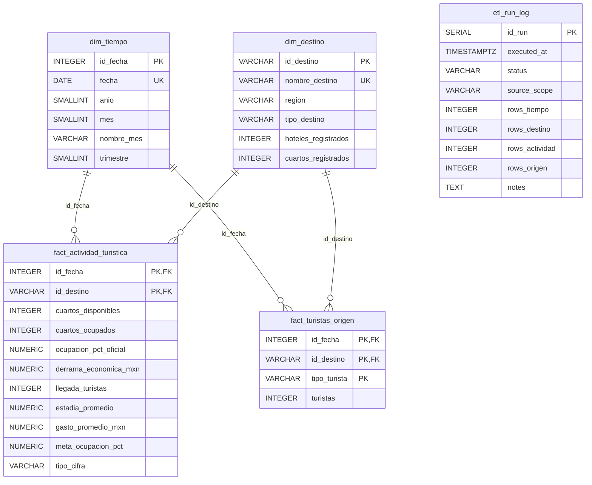

# 5.3. Selección del lenguaje de programación y DBMS a utilizar (Modelo)

## 5.3.1. Selección del lenguaje de programación: Python 3

Para el desarrollo integral del proyecto —adquisición de boletines oficiales, proceso ETL y tablero interactivo— se seleccionó **Python 3** (probado en el entorno `.venv` sobre **Python 3.14.3**) debido a su madurez en ingeniería de datos y analítica descriptiva, así como a la cohesión de su ecosistema de bibliotecas:

| Biblioteca / Tecnología | Rol en el proyecto | Justificación técnica |
|---|---|---|
| **`pandas`** (`>=2.1,<4.0`) | Limpieza, validación y transformación tabular | Permite validar tipos, detectar duplicados, verificar llaves foráneas, conciliar sumas (`Nacional + Extranjero = llegada_turistas`) y calcular agregaciones por razón de sumas de forma vectorizada y legible. |
| **`pdfplumber`** (`>=0.11,<1.0`) y `requests` / `beautifulsoup4` | Extracción reproducible de boletines PDF oficiales | Extrae de manera determinista las tablas mensuales y de inventario hotelero desde los boletines PDF publicados por SECTUR Oaxaca sin depender de transcripción manual. |
| **`SQLAlchemy`** (`>=2.0,<3.0`) y **`psycopg2-binary`** (`>=2.9,<3.0`) | Capa de acceso e ingesta relacional hacia PostgreSQL | Provee manejo transaccional seguro (`engine.begin()`), consultas parametrizadas (`text()`) y carga por lotes (`to_sql(..., method="multi", chunksize=500)`). |
| **`Dash`** (`>=2.16,<5.0`) y **`Plotly`** (`>=5.18,<8.0`) | Frontend analítico interactivo en Python | Permite construir aplicaciones web reactivas, tarjetas KPI, gráficos interactivos y exportación CSV en el mismo lenguaje que el ETL, reduciendo la complejidad tecnológica. |
| **`python-dotenv`** y **`pytest`** | Configuración de entorno y pruebas automatizadas | Separa credenciales mediante `.env` y habilita pruebas unitarias y de integración reproducibles sobre ETL, KPIs, callbacks y servidor HTTP. |

### Comparativa frente a alternativas tecnológicas

Frente a opciones como **R / Shiny** o una arquitectura desacoplada **Node.js + React + scripts separados**, Python ofrece una ventaja práctica decisiva: unifica en un único lenguaje la extracción de PDFs (`pdfplumber`), la validación estadística (`pandas`), la persistencia ORM/SQL (`SQLAlchemy`) y la capa web interactiva (`Dash/Plotly`), manteniendo una curva de aprendizaje moderada y alta mantenibilidad.

## 5.3.2. Selección del Sistema Gestor de Bases de Datos (DBMS): PostgreSQL

Se eligió **PostgreSQL** (compatible con versiones 14 o superiores; probado en entornos con PostgreSQL 16/17) como Sistema Gestor de Bases de Datos relacional por las siguientes razones técnicas:

1. **Integridad estricta mediante restricciones:** Soporta nativamente llaves primarias compuestas, llaves foráneas referenciales y restricciones `CHECK` complejas (por ejemplo, `cuartos_ocupados BETWEEN 0 AND cuartos_disponibles`, `ocupacion_pct_oficial BETWEEN 0 AND 100` y dominios controlados como `tipo_cifra IN ('Cierre', 'Preliminar')` y `tipo_turista IN ('Nacional', 'Extranjero')`).
2. **Funciones analíticas y vistas SQL avanzadas:** Permite definir vistas materializadas lógicas como `vw_kpis_mensuales` y `vw_kpis_anuales_yoy` con funciones de ventana (`LAG() OVER (PARTITION BY id_destino ORDER BY anio)`) para calcular variaciones interanuales directamente en el motor de base de datos.
3. **Control transaccional ACID y auditoría:** La carga idempotente (`TRUNCATE ... CASCADE` seguido de inserción y registro en `etl_run_log`) se ejecuta dentro de una sola transacción atómica, evitando estados intermedios inconsistentes si ocurre algún fallo.
4. **Licenciamiento abierto y estándar SQL:** No impone costos de licencia y facilita el despliegue local o institucional.

## 5.3.3. Arquitectura de persistencia dual (PostgreSQL + respaldo CSV)

El proyecto implementa un **modo dual de operación** controlado mediante la variable de entorno `DASHBOARD_SOURCE` (definida en `.env`, con `.env.example` como plantilla):

- **Modo PostgreSQL (`DASHBOARD_SOURCE=postgres`):** El dashboard consulta directamente las tablas dimensionales y vistas SQL de la base de datos configurada en `DATABASE_URL` (`postgresql+psycopg2://...`). Es el modo recomendado para operación multiusuario, auditoría mediante `etl_run_log` y consultas SQL centralizadas.
- **Modo respaldo CSV (`DASHBOARD_SOURCE=csv`, valor por defecto):** Si no se dispone de una instancia de PostgreSQL activa o no se ha configurado `DATABASE_URL`, `etl/etl.py` igualmente genera en `data/processed/` los cuatro archivos analíticos (`dim_tiempo.csv`, `dim_destino.csv`, `fact_actividad_turistica.csv`, `fact_turistas_origen.csv`) y `metadata_fuentes.json`. El dashboard `app.py` consume exactamente el mismo esquema dimensional desde estos CSV procesados, garantizando portabilidad total y ejecución sin fricción en equipos locales o entornos de evaluación.

## 5.3.4. Modelo dimensional (Esquema Constelación)

El diseño de datos en `sql/schema.sql` adopta un **esquema constelación (fact constellation)** con dos tablas de dimensiones compartidas (`dim_tiempo` y `dim_destino`), dos tablas de hechos con distinta granularidad (`fact_actividad_turistica` y `fact_turistas_origen`) y una tabla operativa de auditoría (`etl_run_log`).

Separar `fact_actividad_turistica` (granularidad **fecha × destino**) de `fact_turistas_origen` (granularidad **fecha × destino × tipo_turista**) evita el producto cartesiano o duplicación de cuartos disponibles, cuartos ocupados y derrama económica cuando se desglosa la llegada de visitantes entre turismo `Nacional` y `Extranjero`.

## 5.3.5. Diccionario de tablas, columnas, llaves y reglas de integridad

### 1. Tabla `dim_tiempo` (44 registros)
Almacena el catálogo temporal mensual con corte el primer día de cada mes (`YYYY-MM-01`).

| Columna | Tipo PostgreSQL | Llave / Restricción | Descripción |
|---|---|---|---|
| `id_fecha` | `INTEGER` | `PRIMARY KEY` | Identificador entero en formato `AAAAMMDD` (ej. `20250101`). |
| `fecha` | `DATE` | `NOT NULL UNIQUE` | Fecha del corte mensual (`YYYY-MM-DD`). |
| `anio` | `SMALLINT` | `NOT NULL CHECK (anio BETWEEN 2018 AND 2035)` | Año calendario de la observación (`2022, 2024, 2025, 2026`). |
| `mes` | `SMALLINT` | `NOT NULL CHECK (mes BETWEEN 1 AND 12)` | Número de mes del 1 al 12. |
| `nombre_mes` | `VARCHAR(15)` | `NOT NULL` | Nombre del mes en español (`Enero` a `Diciembre`). |
| `trimestre` | `SMALLINT` | `NOT NULL CHECK (trimestre BETWEEN 1 AND 4)` | Trimestre calendario (1 a 4). |

### 2. Tabla `dim_destino` (9 registros)
Catálogo maestro de los nueve destinos turísticos oficiales reportados por SECTUR Oaxaca / SIITE.

| Columna | Tipo PostgreSQL | Llave / Restricción | Descripción |
|---|---|---|---|
| `id_destino` | `VARCHAR(30)` | `PRIMARY KEY` | Clave normalizada (`OAX_CENTRO`, `HUATULCO`, `PTO_ESCONDIDO`, `TUXTEPEC`, `ISTMO`, `MIXTECA`, `JUQUILA`, `VENTANILLA_PA`, `RESTO_ESTADO`). |
| `nombre_destino` | `VARCHAR(100)` | `NOT NULL UNIQUE` | Nombre oficial del destino turístico. |
| `region` | `VARCHAR(60)` | `NOT NULL` | Región geográfica de Oaxaca (`Valles Centrales`, `Costa`, `Papaloapan`, `Istmo`, `Mixteca`, `Sierra Sur`, `Estatal`). |
| `tipo_destino` | `VARCHAR(60)` | `NOT NULL` | Vocación turística principal (ej. `Ciudad Patrimonio / Cultural`, `Playa / Surf`). |
| `hoteles_registrados` | `INTEGER` | `CHECK (hoteles_registrados IS NULL OR hoteles_registrados > 0)` | Número de establecimientos de hospedaje registrados en inventario oficial. |
| `cuartos_registrados` | `INTEGER` | `CHECK (cuartos_registrados IS NULL OR cuartos_registrados > 0)` | Número de cuartos disponibles registrados en inventario oficial. |

### 3. Tabla `fact_actividad_turistica` (396 registros)
Tabla de hechos mensual por destino con la capacidad hotelera, ocupación, derrama económica, llegada de turistas, estadía y gasto promedio.

| Columna | Tipo PostgreSQL | Llave / Restricción | Descripción |
|---|---|---|---|
| `id_fecha` | `INTEGER` | `PK, FK -> dim_tiempo(id_fecha)` | Referencia al mes observado. |
| `id_destino` | `VARCHAR(30)` | `PK, FK -> dim_destino(id_destino)` | Referencia al destino turístico. |
| `cuartos_disponibles` | `INTEGER` | `NOT NULL CHECK (cuartos_disponibles > 0)` | Capacidad mensual en cuartos-noche (`cuartos_registrados × días del mes`). |
| `cuartos_ocupados` | `INTEGER` | `NOT NULL CHECK (cuartos_ocupados BETWEEN 0 AND cuartos_disponibles)` | Cuartos-noche ocupados estimados a partir de la ocupación oficial (`round(cuartos_disponibles × ocupacion_pct_oficial / 100)`). |
| `ocupacion_pct_oficial` | `NUMERIC(5,2)` | `NOT NULL CHECK (ocupacion_pct_oficial BETWEEN 0 AND 100)` | Porcentaje de ocupación hotelera publicado en el boletín oficial. |
| `derrama_economica_mxn` | `NUMERIC(16,2)` | `NOT NULL CHECK (derrama_economica_mxn >= 0)` | Derrama económica mensual convertida a pesos mexicanos (`MDP × 1,000,000`). |
| `llegada_turistas` | `INTEGER` | `NOT NULL CHECK (llegada_turistas >= 0)` | Total mensual de llegada de turistas (conciliado contra `Nacional + Extranjero`). |
| `estadia_promedio` | `NUMERIC(5,2)` | `NOT NULL CHECK (estadia_promedio > 0)` | Estadía promedio reportada en noches. |
| `gasto_promedio_mxn` | `NUMERIC(12,2)` | `NOT NULL CHECK (gasto_promedio_mxn >= 0)` | Gasto promedio reportado por turista en MXN. |
| `meta_ocupacion_pct` | `NUMERIC(5,2)` | `NULL CHECK (meta_ocupacion_pct IS NULL OR meta_ocupacion_pct BETWEEN 0 AND 100)` | Meta de ocupación porcentual; permanece `NULL` en datos reales porque los boletines oficiales no publican meta por destino/mes. |
| `tipo_cifra` | `VARCHAR(20)` | `NOT NULL DEFAULT 'Cierre' CHECK (tipo_cifra IN ('Cierre', 'Preliminar'))` | Estatus de publicación oficial (`Cierre` para 2022, 2024, 2025; `Preliminar` para Ene–Ago 2026). |

### 4. Tabla `fact_turistas_origen` (792 registros)
Tabla de hechos mensual por destino y origen del visitante (`Nacional` y `Extranjero`).

| Columna | Tipo PostgreSQL | Llave / Restricción | Descripción |
|---|---|---|---|
| `id_fecha` | `INTEGER` | `PK, FK -> dim_tiempo(id_fecha)` | Referencia al mes observado. |
| `id_destino` | `VARCHAR(30)` | `PK, FK -> dim_destino(id_destino)` | Referencia al destino turístico. |
| `tipo_turista` | `VARCHAR(30)` | `PK, NOT NULL CHECK (tipo_turista IN ('Nacional', 'Extranjero'))` | Segmento de procedencia del turista. |
| `turistas` | `INTEGER` | `NOT NULL CHECK (turistas >= 0)` | Llegada mensual de turistas correspondiente al segmento. |

### 5. Tabla `etl_run_log`
Bitácora operativa para auditar cada ejecución de carga hacia PostgreSQL.

| Columna | Tipo PostgreSQL | Llave / Restricción | Descripción |
|---|---|---|---|
| `id_run` | `SERIAL` | `PRIMARY KEY` | Identificador autoincremental de la corrida ETL. |
| `executed_at` | `TIMESTAMPTZ` | `NOT NULL DEFAULT NOW()` | Marca temporal UTC/zona de ejecución. |
| `status` | `VARCHAR(20)` | `NOT NULL CHECK (status IN ('SUCCESS', 'FAILED'))` | Resultado final de la carga en PostgreSQL. |
| `source_scope` | `VARCHAR(160)` | `NOT NULL` | Alcance cubierto (años procesados). |
| `rows_tiempo` | `INTEGER` | `NOT NULL DEFAULT 0 CHECK (rows_tiempo >= 0)` | Filas cargadas en `dim_tiempo`. |
| `rows_destino` | `INTEGER` | `NOT NULL DEFAULT 0 CHECK (rows_destino >= 0)` | Filas cargadas en `dim_destino`. |
| `rows_actividad` | `INTEGER` | `NOT NULL DEFAULT 0 CHECK (rows_actividad >= 0)` | Filas cargadas en `fact_actividad_turistica`. |
| `rows_origen` | `INTEGER` | `NOT NULL DEFAULT 0 CHECK (rows_origen >= 0)` | Filas cargadas en `fact_turistas_origen`. |
| `notes` | `TEXT` | — | Fecha de corte en corridas exitosas o detalle del error si falla. |

### 6. Índices y vistas analíticas en `sql/schema.sql`

- **Índices de consulta:** `ix_actividad_destino_fecha`, `ix_actividad_fecha`, `ix_origen_tipo_fecha` e `ix_tiempo_anio_mes` optimizan los filtros por año, mes, destino y tipo de turista.
- **Vista `vw_kpis_mensuales`:** Une `fact_actividad_turistica` con `dim_tiempo`, `dim_destino` y una **subconsulta agregada** de `fact_turistas_origen` agrupada por `(id_fecha, id_destino)`. Esta técnica previene la duplicación de `cuartos_disponibles`, `cuartos_ocupados` y `derrama_economica_mxn`, y calcula métricas derivadas como `ocupacion_pct_calculada`, `pct_turistas_extranjeros`, `derrama_por_turista_mxn` y `derrama_por_cuarto_disponible_mxn`.
- **Vista `vw_kpis_anuales_yoy`:** Agrega por año y destino mediante razones de sumas (`agregado_anual`) y utiliza el CTE `con_previo` con `LAG(...) OVER (PARTITION BY id_destino ORDER BY anio)` para calcular la variación interanual de ocupación en puntos porcentuales (`variacion_ocupacion_yoy_pp`), variación porcentual de derrama (`variacion_derrama_yoy_pct`) y variación porcentual de llegada de turistas (`variacion_turistas_yoy_pct`). Además, valida explícitamente `prev_anio = anio - 1 AND prev_meses = meses_cubiertos`, devolviendo `NULL` cuando no hay año consecutivo (como 2024 frente a 2022 por la ausencia de texto extraíble en 2023) o cuando la cobertura mensual difiere (como 2026 con 8 meses frente a 2025 con 12 meses), evitando distorsiones en la comparación YoY.
